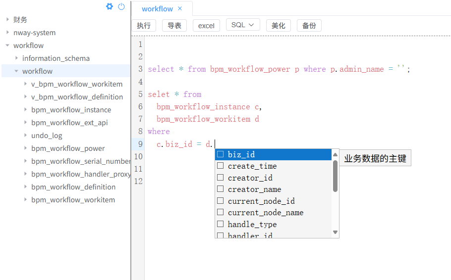
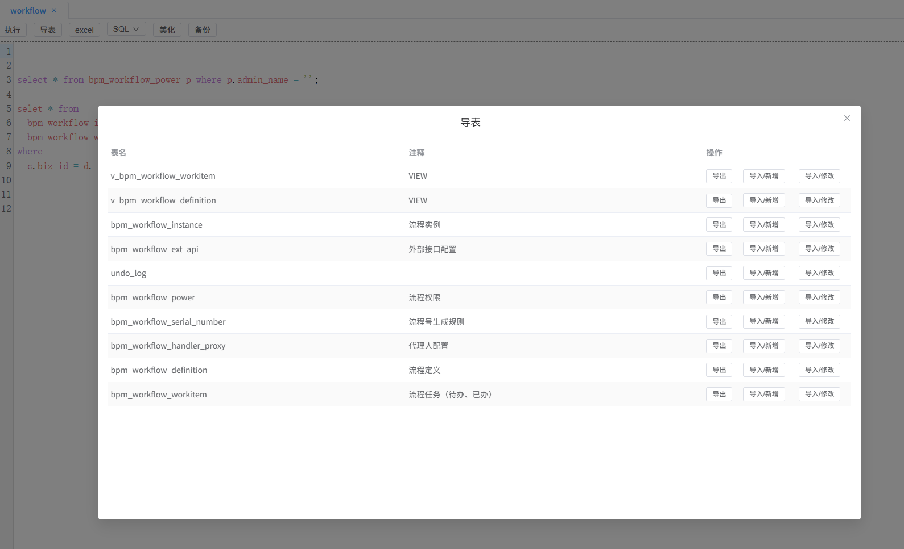
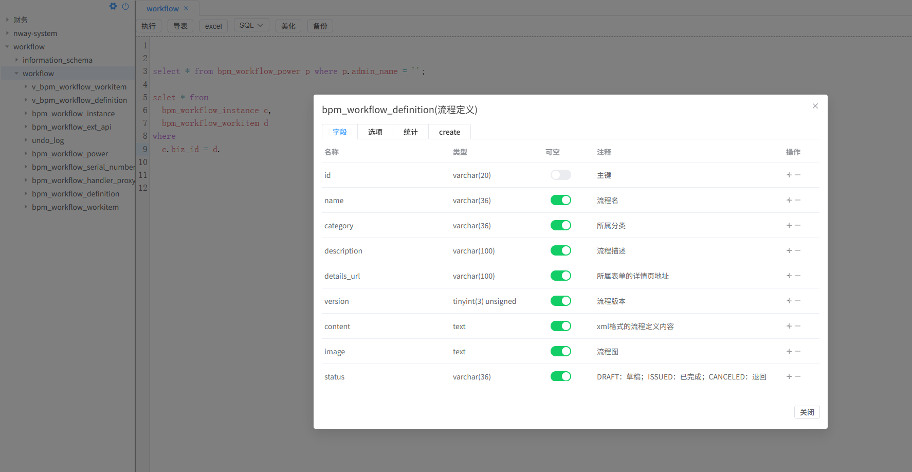
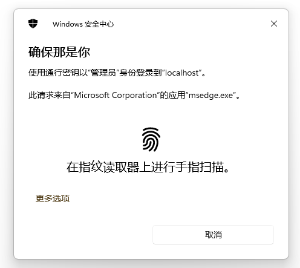

# WebSQL

## AI 原生数据库管理与智能分析平台

[](https://go.dev/)
[](https://vuejs.org/)
[](https://wails.io/)
[](https://github.com/cloudwego/eino)
[](LICENSE)

> **让数据库会思考。**
>
> 自然语言提问，数据库思考作答 —— 洞察分析、出图出报表，端到端智能闭环；
> 双智能体护航写操作，四级权限纵深防御，数据主权尽在掌控。

一款面向数据库管理与数据分析场景的 **AI 原生平台**：把大模型能力与经典数据库管理工具做进同一套代码，以「自然语言驱动 + 智能体协同 + 自主可控部署」为核心，覆盖从个人开发者到企业团队的多元场景。

提供 **Web 版**（解压即用，浏览器访问）与 **桌面版**（原生窗口，本地免登录）两种部署形态 —— 共享同一套 Go 后端与 Vue 前端，功能完全一致。

**在线体验**：[WebSQL 演示环境](http://180.184.30.223:8001/)（账号 `admin` / 密码 `1`）

> 演示服务器上行带宽有限，首次加载可能较慢，请文明使用。

***

## 一、亮点速览

| 你会关心的问题        | WebSQL 的答案                                                              |
| -------------- | ----------------------------------------------------------------------- |
| **不写 SQL 也想出报告** | 一句话提问 → 自动取数 → 10 种图表 → Excel / PPT / Word / HTML 报告直接下载                 |
| **怕 AI 乱改数据**   | 每一次写操作都要过「权限智能体审核 + 危险 SQL 中断审批」，SQL 参数由服务端保管（15 分钟有效），前端无法篡改              |
| **跨库分析要来回倒数据** | 跨库关联在服务端完成 Hash Join，只把匹配统计、聚合指标与少量样本交给模型，海量明细不进入上下文                     |
| **部署嫌麻烦**      | Web 版解压即用，纯 Go 编译无 CGO 依赖，无 JVM / 无 Node 也能跑；一条脚本交叉编译 4 个平台               |
| **涉密与离线环境**    | 支持本地 Ollama 离线推理；桌面版安装包内置 Python 运行时，报告排版开箱即用、全程不联网                      |
| **权限要细到列**     | 连接 → Schema → 表 → 列 四级 RBAC，遵循「最具体优先」，并把权限描述写入 AI 提示词（权限即上下文）            |
| **出事要能追溯**     | 全链路审计 + 经典模式 UPDATE/DELETE 自动历史备份；日志按天轮转保留 7 天，代码库无任何遥测                 |
| **来源可自主**      | MIT 协议，Go + Vue 标准技术栈，无授权服务器依赖、无供应商锁定                                   |

***

## 二、界面一览

**Schema 感知智能补全**：字段名与中文注释随打随提示，补全数据源与 AI 分析用的是同一套表结构元数据



**批量导表**：按表导出、导入新增、导入修改三种动作，字段映射预览后再落库



**表结构在线编辑**：字段 / 选项 / 统计 / DDL 四个维度维护表定义



**指纹 / 面容快捷登录**：浏览器 WebAuthn 通行密钥在本机完成生物识别，密钥绑定账号后一键登录



***

## 三、建设背景与行业痛点

数字化转型的深化，使数据成为政企核心资产，但传统数据库管理工具长期面临「操作门槛高、分析效率低、安全保障弱」三大顽疾：

- **使用门槛高**：业务人员依赖 SQL 技能与 DBA 排期，数据价值释放迟缓
- **分析链路长**：从需求提出到报告产出，需跨越查询、导出、制图、排版多道工序
- **安全风险大**：写操作依赖人员自觉，权限粒度粗，审计追溯能力薄弱
- **部署运维重**：客户端逐台安装，版本难以统一，数据上云又引发主权顾虑
- **替代迫切**：商业工具授权成本高、存在断供风险，自主替代需求迫切

WebSQL 正是为破解上述痛点而生 —— 以 AI 原生架构重塑数据库交互范式，以自主可控的工程实现回应数据主权诉求。

***

## 四、核心能力体系

### 1. AI 智能分析引擎

以字节跳动 **Eino ADK v0.9.19** 的 `ChatModelAgent` 为内核，构建「理解 → 生成 → 执行 → 纠错 → 呈现」的端到端分析链路：

- **自然语言驱动**：用业务语言描述分析目标，智能体自动获取表结构、生成符合方言语法的 SQL 并执行
- **跨库关联分析**：内置 `cross_db_join` 工具，在服务端对两个连接的表执行 Hash Join，仅回传匹配统计（matched / leftOnly / rightOnly）、聚合指标与少量样本行；支持复合 Join Key、两侧条件过滤，明细数据不出服务端
- **文件数据联动**：`read_file_data` 只读读取用户上传的 Excel / CSV / JSON（默认 100 行、最大 500 行，支持分页），可与数据库查询结果做关联对比
- **ReAct 自纠错闭环**：工具执行失败由错误恢复中间件分析成因并调整重试（工具迭代上限 50 轮）；模型调用按错误类型自动重试 —— 429 / 5xx / 超时 / 连接或流中断退避重试（最多 3 次，429 退避更长），401 / 403 / 内容安全过滤不重试，模型返回空响应也会自动补一轮
- **AI 性能优化**：先执行 EXPLAIN，把执行计划注入提示词，由 AI 逐条定位全表扫描、索引未命中、子查询低效、隐式类型转换等问题并给出可执行建议（实现见 `internal/app/sqlopt`）
- **流式实时输出**：基于 SSE 流式传输，分析过程与工具调用进度实时呈现，无需等待
- **上下文工程**：超阈值自动摘要压缩（token 或 200 条消息触发）、超大工具结果自动裁剪并落盘（单条超过 3 万字符）、崩溃或取消后自动补齐 dangling tool_calls，会话可继续
- **上下文韧性**：`AGENTS.md` 运行时规范以瞬态方式在每次模型调用前注入，不进入会话状态、不被摘要压缩

**智能体工具清单**（按代码实际注册整理）：

| 类别        | 工具                                                                                              |
| --------- | ----------------------------------------------------------------------------------------------- |
| 常驻核心（6）   | `query_data`、`get_table_schema`、`list_tables`、`get_current_date_info`、`read_file_data`、`cross_db_join` |
| 按需加载（6）   | `export_excel`、`export_excel_with_chart`、`export_ppt`、`export_analysis_docx`、`export_html`、`exec_sql`（具备写权限时） |
| 中间件注入     | `skill`（加载技能包）、`execute` / `write_file` 等（Eino 文件系统中间件提供的沙箱工具，随运行环境装配）                            |

按需加载工具经「动态工具搜索」中间件按需暴露给模型，避免一次性塞满提示词。

**Skills 扩展引擎**：以 `skills/` 目录下的技能包扩展专业能力（跨库深度分析、Word / PPT / HTML 报告），技能自带依赖声明与命令黑名单，执行层再做一次命令校验，防止通过 Python 子进程绕过沙箱。
技能所依赖的 Excel / PPT / Word 排版脚本，Python 不可用时自动降级为 Go 原生实现，导出不失败；桌面版安装包内置 Python 运行时，专业排版开箱即用。

### 2. 双智能体安全体系（核心创新）

区别于「前端套壳调 LLM」的简易方案，WebSQL 构建了具备工程深度的双智能体纵深防御架构：

- **SQLAgent 主智能体**：基于 Eino ADK，装配 **最多 14 层中间件链**（9 层常驻 + 5 层按运行环境装配），覆盖工具调用、权限、审批、错误恢复、上下文治理与沙箱隔离全链路
- **PermissionAgent 权限智能体**：独立审核每一次数据操作，按「连接 → Schema → 表 → 列」四级粒度逐项校验；LLM 不可用或超时自动降级为程序化权限检查；即便 LLM 放行，高风险写操作仍会由程序再做一次表级复核（双重校验，不依赖模型自觉）
- **防篡改审批流**：识别到写操作（DROP / TRUNCATE / DELETE / ALTER / CREATE / INSERT / UPDATE / REPLACE / MERGE）立即触发中断，原始参数由服务端 CheckPoint 保管（15 分钟有效），前端只能确认或取消，**无法改写 SQL**；一次出现多条危险 SQL 时支持逐条勾选、全选、全部取消，确认后由服务端中断恢复继续执行
- **Skill 守卫**：技能依赖检查 + 命令黑名单（默认黑名单与技能声明合并），命中即拦截，且明确不可通过审批绕过
- **审计留痕**：AI 写操作自动记录审计日志（写操作 / 高风险操作 / Agent 工具调用 / SQL 编辑器执行均可独立开关，默认保留 90 天并定时清理）

**14 层中间件链**构成纵深防御（按注册顺序）：

| #   | 中间件             | 作用                                                    |
| --- | --------------- | ----------------------------------------------------- |
| 1   | 动态系统提示词         | 每次请求重建系统提示词（含表上下文、上传文件、权限描述），避免静态提示词过期                |
| 2   | dangling tool_calls 修补 | 崩溃 / 取消后补齐悬空工具调用，历史会话可直接续跑                            |
| 3   | 工具调用日志          | 记录工具名、参数概要、耗时与结果状态                                    |
| 4   | 动态工具搜索          | 按需把延迟工具暴露给模型，控制提示词体积                                  |
| 5   | 权限审核            | 调用前逐项校验连接 / Schema / 表 / 列权限                            |
| 6   | 危险 SQL 中断审批     | 写操作中断并交由用户确认，参数服务端保管                                  |
| 7   | Skill 守卫        | 技能依赖与命令黑名单校验                                          |
| 8   | 工具错误恢复          | 失败成因分析、参数修正与重试引导                                      |
| 9   | 大结果裁剪 / 落盘      | 单条超过 3 万字符的结果截断并 offload 到文件，兼顾流式体验                    |
| 10  | 上下文摘要压缩         | 触发条件：token 阈值或 200 条消息                                 |
| 11  | AGENTS.md 注入    | 规范内容瞬态注入，不进会话状态、不被压缩                                  |
| 12  | 会话同步            | 摘要压缩后同步会话存储                                           |
| 13  | 文件系统隔离          | 技能执行的工作目录与命令沙箱                                        |
| 14  | Skill 加载        | 按需加载 `skills/` 技能包及其脚本                                 |

> 其中第 4、9、11、13、14 层按运行环境装配（存在延迟工具、技能目录或规范文件时启用），其余 9 层常驻。

### 3. 智能报告生成引擎

一句话生成专业级分析报告，替代「导出数据 → 手动制图 → 排版整合」的传统流程：

- **四大格式全覆盖**：Excel（含图表）/ PowerPoint / Word / HTML，满足不同汇报场景
- **十种可视化图表**：柱状图、横向柱状图、堆叠柱状图、折线图、面积图、饼图、环形图、散点图、雷达图、热力图（matplotlib 渲染，深色 / 浅色双主题）
- **双路径渲染，导出永不失败**：Python 可用时走模板驱动专业排版（python-pptx / python-docx / docxtpl / matplotlib），Python 缺失或渲染异常时自动降级为 Go 原生实现（excelize / go-chart）
- **模板可换肤**：PPT / Word 模板文件可直接用 PowerPoint / WPS / Word 编辑母版与样式，渲染脚本零代码改动
- **HTML 报告增强**：支持 Mermaid 图表与 KaTeX 数学公式，适配复杂数据可视化呈现

### 4. 经典数据库管理

AI 之外，提供全套企业级运维能力，确保「智能」与「专业」并重：

- **智能 SQL 编辑器**：基于 CodeMirror 6，语法高亮 + Schema 感知智能补全（含字段中文注释）+ 内置 EXPLAIN 与 AI 优化面板
- **可视化数据操作**：数据浏览、筛选、排序、编辑与批量操作；导入支持 Excel / CSV / JSON（字段映射预览、新增与更新两种模式），导出支持 Excel / CSV / JSON / SQL
- **ER 图双向工程**：逆向工程（数据库自动生成 ER 图）+ 正向工程（设计图生成 DDL）；支持 AI 依据表名、注释、字段推断表关系，并区分物理外键 / AI 推断 / 手动新增三类连线来源
- **数据字典**：一键生成数据字典并导出 HTML / PDF
- **备份与恢复**：按表选择性备份、AES 加密、异步任务与进度展示，加密备份可解密恢复
- **Schema 结构对比**：自动生成差异 ALTER 语句，可直接应用到目标库
- **数据同步**：自动识别源与目标差异、生成同步 SQL、分块处理大数据量场景，并提供 Dry-Run 试运行、回滚与报告导出
- **跨 Schema 全局搜索**：并发扫描表、列、索引、视图及数据内容，支持跨连接批量搜索
- **实时性能监控**：QPS/TPS、连接池、缓冲池命中率、InnoDB 状态、锁、慢查询、进程列表与会话 Kill、热点表；指标每 60 秒采集一次，历史趋势保留 30 天，并支持对监控变量 / 状态做 AI 分析
- **SQL 收藏夹**：SQL 片段分类、标签、导入导出，后端同步保存

### 5. 权限、认证与审计

- **四级 RBAC 权限模型**：连接 → Schema → 表 → 列，遵循「最具体优先」匹配原则；权限以自然语言注入 AI 系统提示词，实现「权限即上下文」
- **三种认证方式**：密码认证（MD5 + 内置盐值）/ 指纹·面容快捷登录（浏览器 WebAuthn 通行密钥，本机校验后绑定密钥登录）/ 第三方 Token 认证
- **本地模式免登录**：Web 本地模式与桌面版自动以本地用户身份运行并拥有全部权限，非本地 Web 模式的多用户场景启用完整权限管控
- **访问限流**：登录 `0.5 次/秒`（约 30 次/分钟，突发 5）、AI 接口 `10 次/秒`（突发 50）、普通 API `50 次/秒`（突发 100）
- **全链路审计**：AI 写操作自动记录审计日志；经典模式 UPDATE / DELETE 自动备份至历史表，支持操作追溯
- **运行韧性**：主 goroutine panic 兜底、关键后台任务命名化 recover、SQL 执行历史异步批写、HTTP 优雅关闭；日志按天轮转，保留 7 天

### 6. 关键实现索引（节选）

| 能力                  | 代码位置                                    |
| ------------------- | --------------------------------------- |
| 智能体装配与 14 层中间件链     | `internal/ai/agent/builder.go`          |
| 工具定义与动态工具加载         | `internal/ai/agent/agent.go`            |
| 权限智能体与程序化降级         | `internal/ai/agent/permagent.go`、`permmw.go` |
| 危险 SQL 识别与中断审批      | `internal/ai/agent/permcheck.go`、`sqlutil/sqldetect.go` |
| 中断状态保存与恢复（15 分钟）    | `internal/ai/agent/checkpoint.go`       |
| Skill 守卫与命令黑名单      | `internal/ai/agent/skillguard.go`、`skillmeta.go` |
| 权限范围与提示词注入          | `internal/ai/agent/scope.go`、`prompts.go` |
| 报表渲染（Go / Python 双路径） | `internal/ai/agent/export/`、`skills/`   |
| SQL 优化（EXPLAIN + AI） | `internal/app/sqlopt/`                  |
| 结构对比与数据同步           | `internal/app/sync/`                    |
| 备份恢复（AES 加密）        | `internal/app/backup/`                  |
| ER 图与数据建模           | `internal/app/modeler/`                 |
| 性能监控与指标采集           | `internal/app/monitor/`                 |
| 审计服务                | `internal/audit/`                       |
| 四级权限与登录             | `internal/app/permission/`、`internal/app/admin/` |
| 多数据库方言适配            | `internal/dialect/`                     |
| 管理库迁移系统             | `internal/migration/`、`migrations/`      |
| 桌面版入口与资源内嵌          | `cmd/desktop/`                          |

***

## 五、双形态部署架构

WebSQL 提供 **Web 版**与 **桌面版**两种部署形态，共享同一套 Go 后端服务与 Vue 前端界面，功能完全一致：

| 维度        | Web 版                          | 桌面版                                     |
| --------- | ------------------------------ | --------------------------------------- |
| **部署形态**  | 解压即用的单服务，部署于服务器                | 原生桌面窗口，双击即用                             |
| **访问方式**  | 浏览器访问 HTTP / HTTPS             | Wails v3 WebView2 原生窗口                  |
| **用户认证**  | 密码 / 指纹·面容 / 第三方 Token         | 免登录，自动以本地用户身份运行                         |
| **权限模式**  | 四级 RBAC 权限控制                  | 本地模式，拥有全部权限                             |
| **管理库**   | MySQL / MariaDB / SQLite       | SQLite（纯 Go 实现，零外部依赖）                    |
| **报告排版**  | 复用系统 Python，缺失时降级 Go 实现         | 安装包内置 Python 运行时，专业排版开箱即用                |
| **数据持久化** | 服务器本地存储                        | exe 同目录的 SQLite 管理库 + 用户数据后端 KV 同步，重启不丢失  |
| **协作模式**  | 多用户共享，团队协作                     | 单用户本地使用                                 |
| **适用场景**  | 企业团队共享、远程运维、多用户权限管控            | 个人开发者、本地快速操作、涉密离线环境                     |

### Web 版

- **解压即用，零外部运行时**：纯 Go 编译（`CGO_ENABLED=0`），无 CGO、无 JVM、无 Node 依赖；SQLite 迁移脚本随二进制内嵌，前端静态资源与技能包随发行包分发
- **跨平台编译**：支持在任意平台交叉编译 Windows / Linux / macOS（amd64 / arm64）产物
- **HTTPS 开箱可用**：`-https` 启动即自动生成自签名证书（有效期 10 年，证书信息取自 `config.json`），浏览器首次访问需手动信任
- **容器化友好**：仓库内置 `Dockerfile`，一条命令构建镜像

### 桌面版

基于 [Wails v3](https://wails.io/) 构建，将 Web 前端包装为原生桌面应用：

- **原生窗口体验**：Windows Mica 背景效果、系统主题跟随、任务栏闪烁提醒
- **单实例运行**：同一时间仅允许运行一个实例，重复启动时激活已有窗口
- **全量内嵌**：前端资源、配置与迁移脚本均通过 `go:embed` 嵌入二进制；`skills/` 与 Python 运行时随安装包分发，真正的开箱即用
- **零配置启动**：无需安装数据库驱动、无需配置文件，双击即可使用；本地监听随机可用端口，避免端口冲突
- **进程级资源清理**：Windows 下通过 Job Object 在主进程退出时自动终止 WebView2 子进程，无残留
- **支持平台**：Windows / macOS / Linux（因 Wails 依赖 CGO，需在目标平台构建）

***

## 六、技术架构与先进性

### 架构理念

WebSQL 秉承 **「AI 原生、双形态交付、数据不出域」** 三大设计理念，以工程化方式将大模型能力深度嵌入数据库管理全链路，而非简单的外挂式调用。

### 技术栈

| 维度      | 技术选型                                                | 先进性说明                                                     |
| ------- | --------------------------------------------------- | --------------------------------------------------------- |
| **智能体框架** | 字节跳动 Eino ADK v0.9.19                               | ChatModelAgent + 中断恢复 + CheckPoint 持久化 + 中间件链，工业级智能体框架      |
| **大模型支持** | OpenAI 兼容 API + 本地 Ollama                           | 云端高性能 + 本地离线；调用失败按错误类型退避重试，空响应自动补轮                         |
| **后端**    | Go 1.26 + Gin 1.12                                  | 高并发、低内存、编译型安全                                             |
| **桌面框架**  | Wails v3.0.0-beta.10                                | Go + WebView2 原生桌面应用，单实例、系统主题、任务栏通知                       |
| **数据库引擎** | 管理库：纯 Go SQLite（modernc.org/sqlite）/ MySQL / MariaDB；受管库：MySQL、MariaDB、Oracle、SQLite | 管理库零外部依赖（无 CGO），四种受管数据库均有方言适配                            |
| **前端**    | Vue 3.5 + TypeScript + Element Plus 2.13            | 响应式现代 Web，浏览器即客户端                                         |
| **SQL 编辑器** | CodeMirror 6 + lang-sql                             | 语法高亮 + Schema 感知智能补全                                       |
| **数据可视化** | ECharts 6 + AntV X6 + Mermaid 11 + KaTeX            | 图表、ER 图、流程图、公式全场景覆盖                                       |
| **报表渲染**  | excelize / go-chart + python-pptx / python-docx / matplotlib | Go 与 Python 双路径，Python 缺失自动降级，导出永不失败                      |
| **通信协议**  | HTTP / SSE                                          | 流式实时输出，支持自签名 HTTPS 加密传输                                    |
| **安全加密**  | AES + WebAuthn 通行密钥                                 | 备份加密 + 本机生物识别登录                                           |
| **管理库迁移** | 嵌入式增量迁移 + 全量脚本兜底                                    | 版本化迁移系统，启动时自动升级；SQLite 自动执行，MySQL/MariaDB 由管理员执行          |

### 架构优势

- **双形态交付**：Web 版解压即用，桌面版双击即用，同一套代码两种交付形态
- **零运行时依赖**：Web 版纯 Go 编译（无 CGO），桌面版仅依赖系统 WebView，可快速部署于物理服务器、虚拟化平台及容器环境
- **数据主权可控**：所有数据不离开服务器 / 本机，支持本地 Ollama 离线运行 AI，满足数据不出域的合规要求
- **纵深防御**：双智能体 + 14 层中间件链 + 四级权限 + 防篡改审批 + 全链路审计 + 分级限流，安全能力可查可验证
- **健壮性设计**：模型调用重试退避、工具错误恢复、崩溃续跑、panic 兜底、优雅关闭，保障服务持续可用
- **代码规模可考**：167 个 Go 源文件（约 4.2 万行）、105 个前端源文件（63 个 `.vue` + 42 个 `.ts`，约 3.2 万行），无遥测代码

***

## 七、对标分析

| 维度     | 传统工具          | WebSQL                                    |
| ------ | ------------- | ----------------------------------------- |
| 查询方式   | 手写 SQL        | AI 自然语言驱动 + 经典手写 SQL 双模式                  |
| 报告产出   | 导出数据，手动制图黏贴   | 一句话生成含图表的 Excel / PPT / Word / HTML      |
| 写操作安全  | 依赖操作人员自觉      | 权限智能体审核 + 防篡改中断审批 + 四级权限 RBAC + 全链路审计        |
| 权限粒度   | 连接级           | 四级 RBAC（连接—Schema—表—列）                    |
| 认证方式   | 账号密码          | 密码 / 指纹·面容（WebAuthn 通行密钥）/ 第三方 Token      |
| 部署形态   | 逐台安装客户端       | Web 版解压即用 / 桌面版双击即用 / Docker              |
| 协作方式   | 各自安装客户端       | 浏览器打开团队共享 / 桌面版本地免登录                      |
| 错误处理   | SQL 报错，手动修改   | AI 自动分析错误，调整参数重试（ReAct 循环）                |
| 跨库查询   | 逐个连接切换，手动合并   | 服务端 Hash Join，仅返回统计与样本，明细不出服务端            |
| SQL 优化 | 手动 EXPLAIN 分析 | 执行计划自动注入提示词，AI 逐条定位瓶颈并给出可执行建议             |
| 授权模式   | 商业授权，存在断供风险   | MIT 开源，无授权绑定，无供应商锁定                       |
| 数据主权   | 数据可能需上云       | 数据不出服务器 / 本机，支持离线 AI                      |

***

## 八、数据库支持

| 数据库             | 查询 | 写操作 | 导入导出 | 结构编辑与 DDL | 性能监控 | 用户与权限管理 | AI 方言适配 |
| --------------- | -- | --- | ---- | --------- | ---- | ------- | ------- |
| MySQL / MariaDB | ✓  | ✓   | ✓    | ✓         | ✓    | ✓       | ✓       |
| Oracle          | ✓  | ✓   | ✓    | ✓         | —    | ✓       | ✓       |
| SQLite          | ✓  | ✓   | ✓    | ✓         | —    | —       | ✓       |

> 说明：性能监控（QPS/TPS、InnoDB 状态、锁、慢查询等）为 MySQL / MariaDB 专属能力；数据库用户与权限管理支持 MySQL / MariaDB / Oracle；SQLite 无存储过程与事件概念，方言层已做适配。

***

## 九、快速开始

> **关于发行包下载的说明**
>
> 作者多次尝试在 Gitee 仓库中上传打包后的可执行文件（Web 版二进制、桌面版安装包），但由于 Gitee 对单文件大小有严格限制（普通仓库 100MB，且对二进制大文件上传稳定性较差），多次上传均以失败告终。**仓库不提供预编译发行包**，请用户按照下方指引自行编译打包。整个过程已脚本化，环境准备就绪后一条命令即可完成。

### 9.1 环境准备

#### 通用环境（Web 版与桌面版均需要）

| 工具          | 版本要求      | 安装说明                                                          |
| ----------- | --------- | ------------------------------------------------------------- |
| **Go**      | 1.26+     | https://go.dev/dl/                                           |
| **Node.js** | 18+       | https://nodejs.org/ （建议使用 LTS 版本）                             |
| **npm**     | 随 Node.js | 用于构建前端                                                       |
| **Python**  | 3.8+      | 用于执行打包脚本（`scripts/build_release.py`、`scripts/build_desktop.py`） |

#### 桌面版额外环境（Wails v3 依赖 CGO，**无法交叉编译**）

| 平台        | 额外依赖                                                                          |
| --------- | ----------------------------------------------------------------------------- |
| **Windows** | WebView2 Runtime（Win10/11 通常自带，缺失可从微软官网下载）                                    |
| **macOS** | Xcode Command Line Tools（`xcode-select --install`）                            |
| **Linux** | `libgtk-3-dev`、`libwebkit2gtk-4.1-dev`（Debian/Ubuntu：`apt install`；CentOS：`dnf install`） |

并安装 Wails v3 CLI：

```bash
go install github.com/wailsapp/wails/v3/cmd/wails3@latest
```

#### 验证环境

```bash
go version          # 应输出 go1.26+
node --version      # 应输出 v18+
wails3 version      # 仅桌面版必需
```

### 9.2 获取源码

```bash
git clone https://gitee.com/nway/websql.git
cd websql
```

### 9.3 编译打包 Web 版（纯 Go，支持交叉编译）

Web 版采用 `CGO_ENABLED=0` 纯 Go 编译，SQLite 迁移脚本通过 `go:embed` 嵌入二进制。**可在任意平台交叉编译全部目标平台**，无需在目标平台运行。

**推荐：使用跨平台打包脚本 `scripts/build_release.py`（Windows / Linux / macOS 均可运行）：**

```bash
python scripts/build_release.py                          # 交互式选择目标平台
python scripts/build_release.py --platform windows       # 仅 Windows
python scripts/build_release.py --platform linux         # 仅 Linux
python scripts/build_release.py --platform macos         # macOS（amd64 + arm64）
python scripts/build_release.py --platform all           # 全部平台
python scripts/build_release.py --skip-frontend          # 跳过前端构建
python scripts/build_release.py --skip-build             # 跳过 Go 编译（使用已有二进制）
python scripts/build_release.py --skip-db                # 跳过全新数据库创建
```

**Windows 平台也可使用批处理脚本 `scripts\release.bat`（功能等价）：**

```bat
scripts\release.bat              :: 交互式选择目标平台
scripts\release.bat windows      :: 仅 Windows
scripts\release.bat linux        :: 仅 Linux
scripts\release.bat macos        :: 仅 macOS（amd64 + arm64）
scripts\release.bat all          :: 全部平台
```

**支持的 Web 版目标平台：**

| 平台标识            | 说明                  |
| --------------- | ------------------- |
| `windows-amd64` | Windows x86_64      |
| `linux-amd64`   | Linux x86_64        |
| `macos-amd64`   | macOS Intel         |
| `macos-arm64`   | macOS Apple Silicon |

**产物：** `dist-pack/websql-web-{platform}.zip`，包内含可执行文件、前端静态资源（`static/`）、迁移脚本（`migrations/`）、配置文件（`config.json`）、预置 SQLite 管理库（`nway.sqlite3.db`）、`db_migrate.py` 升级工具、`skills/` 目录及 `startup` 启动脚本，解压即可运行。

**手动单平台快速编译（不打包，仅产出二进制）：**

```bash
# Linux / macOS
CGO_ENABLED=0 GOOS=linux GOARCH=amd64 go build -o WebSql main.go

# Windows（PowerShell）
$env:CGO_ENABLED=0; $env:GOOS="windows"; $env:GOARCH="amd64"; go build -o WebSql.exe main.go
```

> 注：手动编译产出的裸二进制已内嵌 SQLite 迁移脚本，但**不包含前端静态资源与配置文件**（Web 版前端为外置 `static/` 目录），需自行准备 `static/`、`config.json` 等附属文件才能正常运行。生产部署推荐使用打包脚本。

### 9.4 编译打包桌面版（Wails v3，需在目标平台运行）

桌面版基于 Wails v3，依赖 CGO，**必须在目标平台原生构建**，无法交叉编译。脚本会自动检测当前平台。

```bash
python scripts/build_desktop.py                          # 自动检测当前平台并完整构建（交互式询问是否捆绑 Python，默认否）
python scripts/build_desktop.py --skip-frontend          # 跳过前端构建（适用于已构建过前端的场景）
python scripts/build_desktop.py --package                # 调用 wails3 build 完整构建与打包
python scripts/build_desktop.py --check                  # 仅检查环境，不构建
```

> 是否捆绑 Python 运行时在构建过程中交互式询问（`[y/N]`，直接回车即跳过）；跳过时 Skill 导出将使用系统 Python 或降级 Go 基础版。

**产物：** `dist-pack/websql-desktop-{platform}.zip`，包内为单个可执行文件（前端资源、配置、迁移脚本均通过 `go:embed` 嵌入）以及随包分发的 `skills/` 技能目录与 `python/` 内置运行时。

### 9.5 启动与部署（Web 版）

**使用打包产物部署（推荐）：**

```bash
# 解压产物（包内已含预置 SQLite 管理库，开箱即用）
unzip websql-web-linux-amd64.zip -d websql
cd websql

# 启动服务（默认端口 80，可通过 -port 指定）
./WebSql -port 8080

# 启用 HTTPS（默认端口 443，自签名证书自动生成于程序同目录）
./WebSql -https

# 后台运行（Linux）
nohup ./WebSql -port 8080 > websql.log 2>&1 &

# 或使用包内 startup 脚本
./startup.sh    # Linux / macOS
startup.bat     # Windows
```

**使用 MySQL / MariaDB 作为管理库（可选）：**

打包产物默认使用 SQLite 管理库（`nway.sqlite3.db`），开箱即用无需配置。如需切换为 MySQL / MariaDB 管理库，需手动执行全量初始化脚本并修改 `config.json`：

```bash
# 1. 在 MySQL 中创建数据库并执行全量初始化脚本
mysql -u root -p -e "CREATE DATABASE websql DEFAULT CHARSET utf8mb4;"
mysql -u root -p websql < migrations/full/mysql_full.sql

# 2. 修改 config.json，将 db.type 改为 "mysql"，db.dsn 改为 MySQL 连接串
# {
#   "isRemote": true,
#   "db": {
#     "type": "mysql",
#     "dsn": "user:password@tcp(127.0.0.1:3306)/websql?charset=utf8mb4&parseTime=true",
#     ...
#   }
# }

# 3. 启动服务（后续版本升级时，由系统管理员手动执行增量脚本）
./WebSql -port 8080
```

> 注：SQLite 管理库的版本升级由程序启动时自动执行迁移脚本完成；MySQL / MariaDB 管理库的版本升级需要系统管理员手动执行 `migrations/full/mysql_full.sql` 中的增量部分。

### 9.6 Docker 容器化部署（Web 版）

项目根目录提供 `Dockerfile`，基于 Ubuntu 22.04，构建时自动安装 Go 与 Node.js、克隆源码、编译前后端并打入镜像，产出可直接运行的镜像，容器内默认以 HTTP 80 端口启动。

```bash
# 构建镜像
docker build -t websql .

# 运行容器（容器内监听 80，映射为宿主 8080 端口）
docker run -d -p 8080:80 -v websql-logs:/app/logs websql

# 启用 HTTPS（端口 443）
docker run -d -p 443:443 websql /app/WebSql -https -port 443
```

> 持久化说明：容器内管理库默认位于 `/app/nway.sqlite3.db`、日志位于 `/app/logs`。如需持久化 SQLite 管理库，请在构建前把 `config.json` 的 `db.dsn` 改为 `./data/nway.sqlite3.db`（`Dockerfile` 会将该文件复制进镜像），再挂载 `-v websql-data:/app/data`；如需使用 MySQL 管理库，同样在构建前修改 `config.json` 即可。

### 9.7 前端二次开发

```bash
cd web-src && npm install
npm run dev     # 启动开发服务器（热重载）
npm run build   # 构建生产产物到 web-src/dist/
```

> 前端构建产物默认位于 `web-src/dist/`，Web 版将其作为外置 `static/` 目录随包分发，桌面版通过 `scripts/build_desktop.py` 自动复制到 `cmd/desktop/static/` 并内嵌进二进制。

### 9.8 常见问题

**Q1：桌面版构建失败提示 "CGO disabled" 或链接错误？**

Wails v3 依赖 CGO，请确保：

- 环境变量 `CGO_ENABLED=1`
- 已安装对应平台的 C 编译器（Windows 为 MinGW-w64，macOS 为 Xcode CLT，Linux 为 gcc）
- Windows 平台需安装 WebView2 Runtime（Win10/11 通常自带）

**Q2：Gitee 上传大文件失败如何分发已编译产物？**

Gitee 对单文件大小有严格限制，建议改用以下方式分发：

- GitHub Releases（支持单文件最大 2GB）
- 阿里云 OSS / 腾讯云 COS 等对象存储服务
- 将 zip 包分卷压缩后上传（如 `split -b 50m websql-web-linux-amd64.zip`）

**Q3：交叉编译桌面版失败？**

Wails v3 不支持交叉编译，**必须在目标平台原生构建**。如需 Windows 桌面版，请在 Windows 上运行 `python scripts/build_desktop.py`；如需 macOS 桌面版，请在 macOS 上运行。Linux 桌面版需先安装 `libgtk-3-dev` 和 `libwebkit2gtk-4.1-dev`。

**Q4：启动后浏览器无法访问？**

- 检查端口是否被占用：`netstat -an | grep 8080`
- 检查防火墙是否放行对应端口
- 查看日志：`./logs/websql-YYYY-MM-DD.log`（日志按天轮转，保留 7 天）或容器内 `/app/logs/`
- 若以 `-https` 启动，访问地址应为 `https://host:port`，自签名证书需浏览器手动信任

**Q5：Web 版打包脚本 `build_release.py` 与 `release.bat` 有何区别？**

两者均产出 `dist-pack/websql-web-{platform}.zip`。`build_release.py` 是 Python 脚本，可在 Windows / Linux / macOS 任意平台运行，并会用全量脚本预置一个全新的 SQLite 管理库；`release.bat` 是 Windows 批处理脚本，仅限 Windows，不含预置管理库（首次启动自动建库）。推荐优先使用 `build_release.py`。

**Q6：如何升级到新版本？**

- **Web 版**：重新拉取代码并打包，替换部署目录中的二进制与 `static/`、`migrations/` 目录，保留 `config.json` 与 `nway.sqlite3.db`（或 MySQL 管理库），重启服务。SQLite 管理库会自动迁移；MySQL/MariaDB 管理库需手动执行增量脚本。
- **桌面版**：重新构建并替换可执行文件即可，用户数据保存在 exe 同目录（`nway.sqlite3.db` 管理库、`logs/` 日志，exe 目录无写权限时日志回退到 `%APPDATA%/WebSQL/logs`），不会丢失。

**Q7：AI 分析报错或想更换模型怎么办？**

系统支持 OpenAI 兼容接口与本地 Ollama 两类模型，可在系统设置中维护模型列表与默认模型（含 baseUrl、apiKey、温度等参数）。模型调用遇到 429、5xx、超时、连接中断会自动退避重试；401 / 403 或密钥错误不会重试，请检查模型配置。

***

## 十、开源与自主可控优势

- **MIT 开源许可**：无限制商用、自由修改、自由分发，无 Copyleft 限制，无「企业版」功能阉割
- **数据主权可控**：Web 版部署于自有服务器，桌面版本地运行，数据不出域；支持本地 Ollama 离线运行 AI，满足数据不出域要求
- **零遥测代码**：不包含任何遥测、行为追踪或数据收集代码，代码完全公开可审计
- **零供应商锁定**：基于标准 SQL 与 HTTP/SSE 协议，Go + Vue 3 标准技术栈，无商业授权服务器依赖
- **信创环境适配**：纯 Go 编译，Web 版无 CGO 依赖，可适配信创操作系统与硬件环境
- **关键能力可验证**：智能体装配、审批中断、权限校验、报表渲染等核心实现均可在仓库中按「关键实现索引」直接查阅
- **社区驱动演进**：所有功能模块均无「企业版」限制，欢迎通过 Issues / Pull Requests 贡献

***

## License

[MIT](LICENSE)