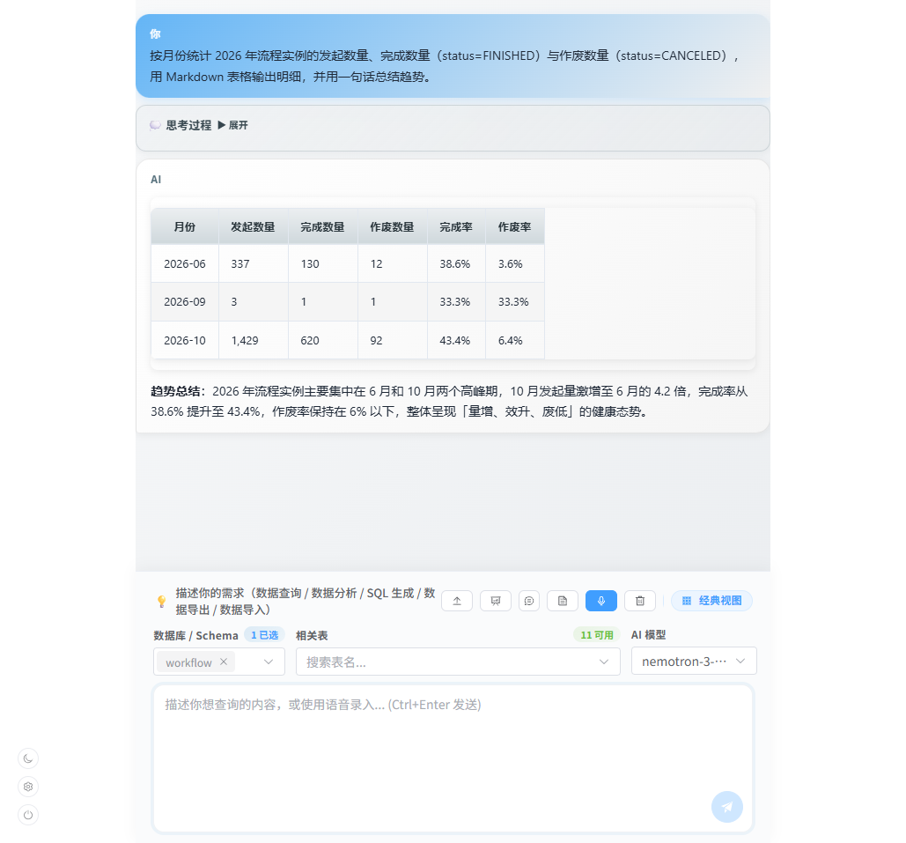
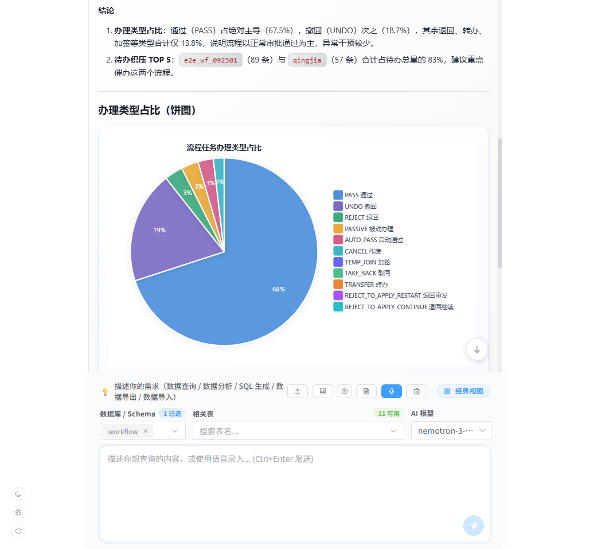
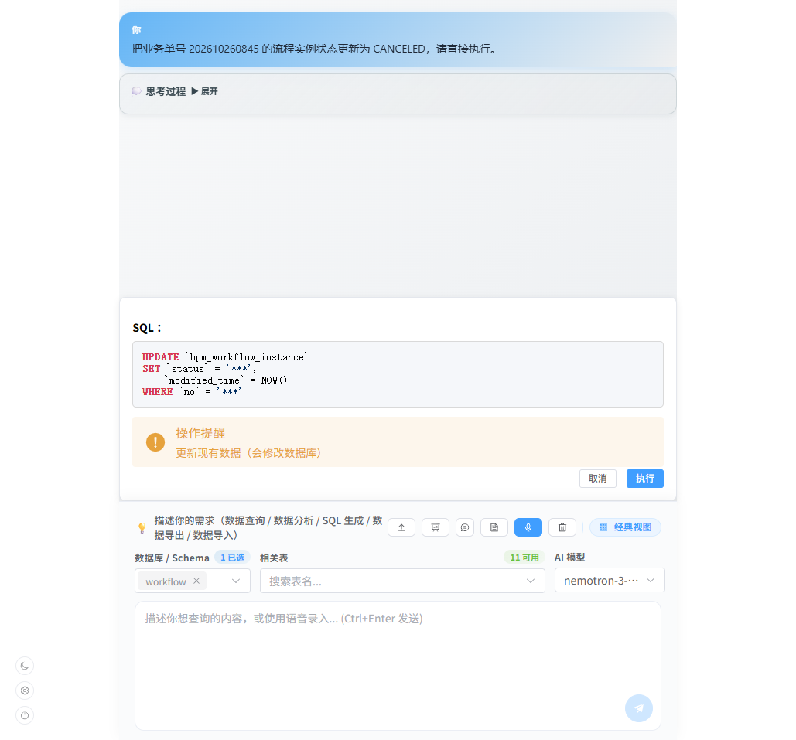
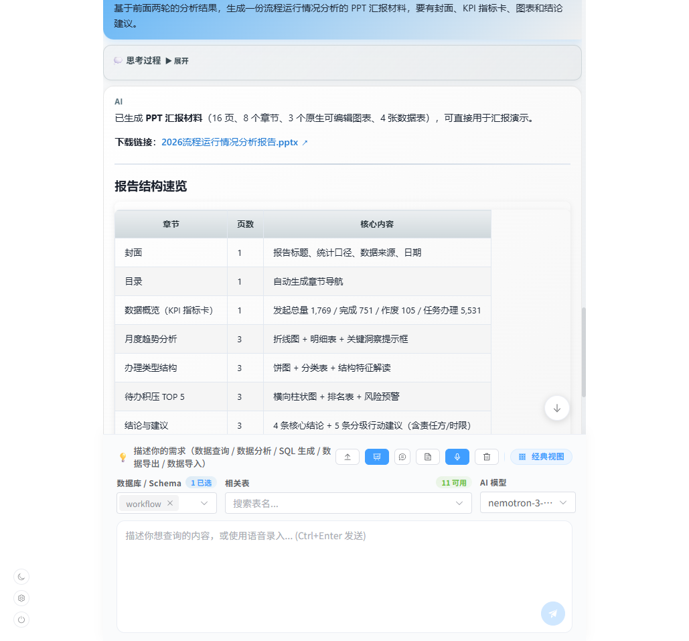
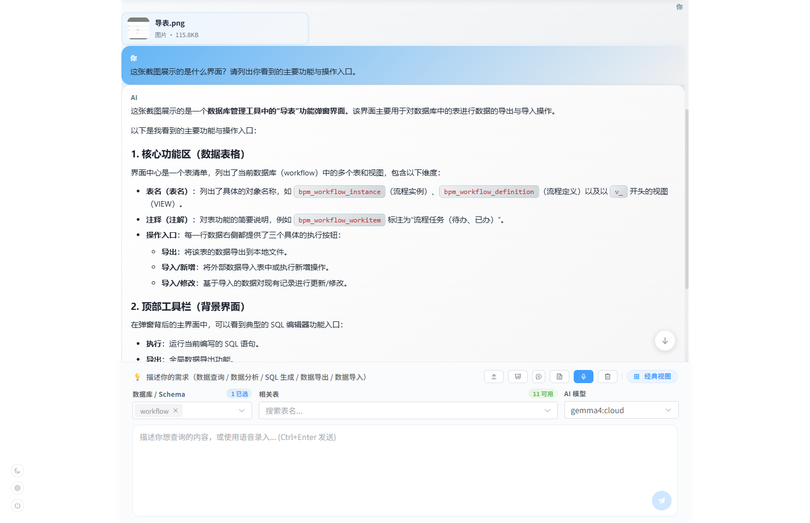
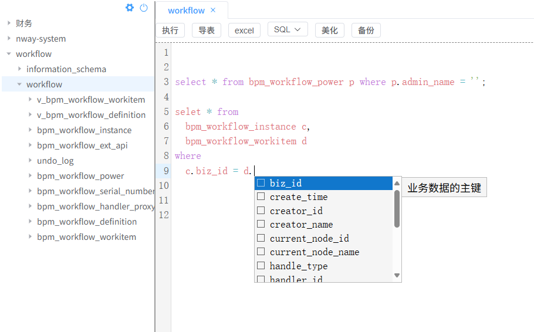
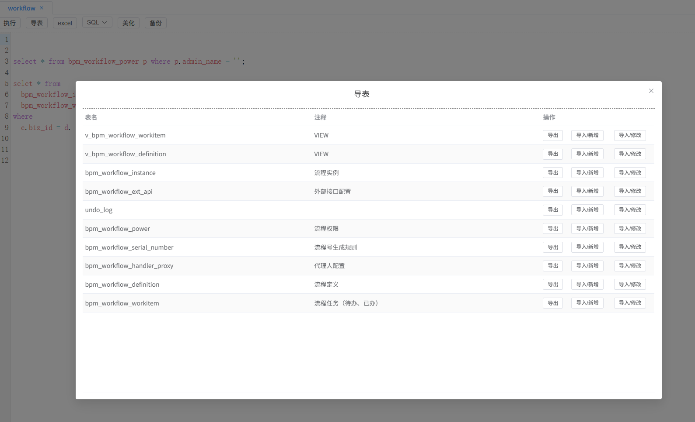
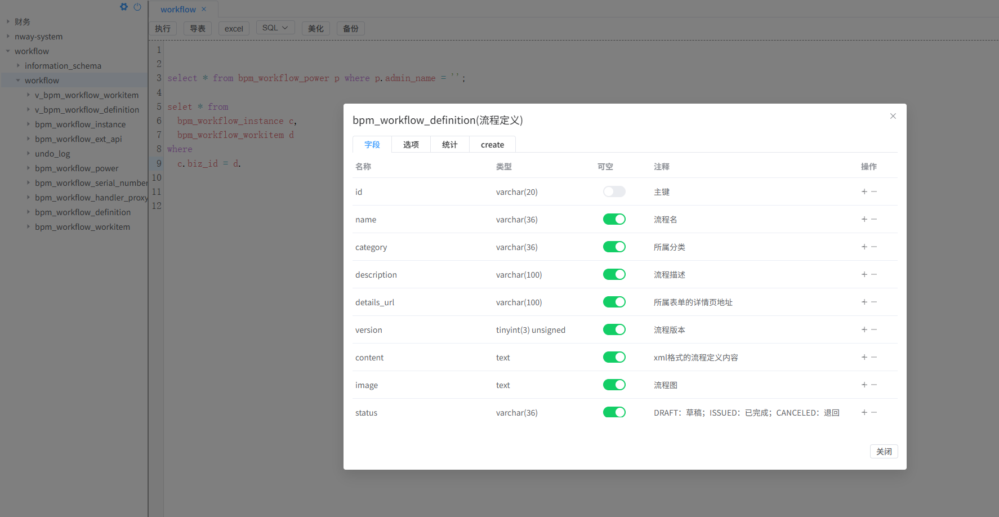
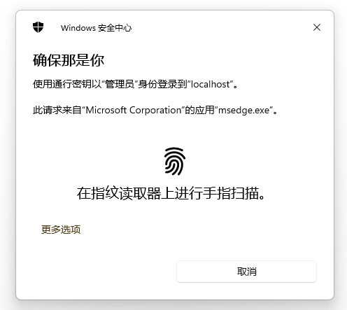

# WebSQL

## AI 原生数据库管理与智能分析平台

[](https://go.dev/)
[](https://vuejs.org/)
[](https://wails.io/)
[](https://github.com/cloudwego/eino)
[](LICENSE)

> **让数据库会思考。**
>
> 自然语言提问，数据库思考作答 —— 洞察分析、出图出报表，端到端智能闭环；
> 双智能体护航写操作，四级权限纵深防御，数据主权尽在掌控。

一款面向数据库管理与数据分析场景的 **AI 原生平台**：把大模型能力与经典数据库管理工具做进同一套代码，覆盖从个人开发者到企业团队的多元场景。提供 **Web 版**（解压即用，浏览器访问）与 **桌面版**（原生窗口，本地免登录）两种部署形态，共享同一套 Go 后端与 Vue 前端，功能完全一致。

**AI 智能对话实拍**（自然语言问数 → 图表可视化 → 写操作审批 → 报告导出 → 图像理解）

| 自然语言问数：自动取数、结果表格与趋势结论 | 智能可视化：先结论后 Mermaid 图表 |
| --- | --- |
|  |  |

| 危险写操作中断审批：SQL 由服务端保管，前端只能确认或取消 | 报告级导出：一句话生成可下载的 PPT 汇报材料 |
| --- | --- |
|  |  |

图像理解：上传截图，多模态模型识别界面要素并逐项说明



> 以上截图均为真实运行效果（模型：`nemotron-3-ultra:cloud` 文本、`gemma4:cloud` 文本 + 图像，OpenAI 兼容协议），未做后期处理。

**经典数据库管理**

| Schema 感知智能补全 | 批量导表 |
| --- | --- |
|  |  |

| 表结构在线编辑 | 指纹 / 面容快捷登录 |
| --- | --- |
|  |  |

**快速导航**：[亮点速览](#亮点速览) · [快速开始](#快速开始) · [双形态部署](#双形态部署) · [核心能力](#核心能力) · [数据库支持](#数据库支持) · [技术栈](#技术栈) · [项目结构](#项目结构) · [开发与测试](#开发与测试) · [文档导航](#文档导航)

***

## 亮点速览

| 你会关心的问题 | WebSQL 的答案 |
| -------------- | ------------- |
| **不写 SQL 也想出报告** | 一句话提问 → 自动取数 → 九种原生图表 → Excel / PPT / Word / HTML 报告直接下载 |
| **怕 AI 乱改数据** | 每一次写操作都要过「权限智能体审核 + 危险 SQL 中断审批」，SQL 参数由服务端保管（30 分钟有效），前端无法篡改 |
| **生产库怕误写** | 连接级只读开关：只读状态下经典 SQL 写语句与表结构变更直接拒绝，需在连接管理临时解锁（界面 5 分钟，进程重启即失效） |
| **内网库连不上** | 内置 SSH 跳板机隧道，支持密码 / 私钥与 known_hosts 校验；隧道建立失败不会回退为直连 |
| **结果太大卡页面** | 结果集分页 +「继续加载」；CSV / JSON / SQL 导出由服务端逐行流式写响应，SQL 执行可服务端终止 |
| **跨库分析要来回倒数据** | 跨库关联在服务端完成 Hash Join，只把匹配统计、聚合指标与少量样本交给模型，海量明细不进入上下文 |
| **部署嫌麻烦** | Web 版解压即用，纯 Go 编译无 CGO 依赖，无 JVM / 无 Node 也能跑；一条脚本交叉编译 4 个平台 |
| **涉密与离线环境** | 支持本地 Ollama 离线推理；标准报告由 Go 原生引擎渲染，无 Python 也能导出；桌面版构建时可选择捆绑 Python 运行时 |
| **权限要细到列** | 连接 → Schema → 表 → 列 四级 RBAC，遵循「最具体优先」，并把权限描述写入 AI 提示词（权限即上下文） |
| **出事要能追溯** | 全链路审计 + 经典模式 UPDATE/DELETE 自动历史备份；日志按天轮转保留 7 天，代码库无任何遥测 |
| **来源可自主** | MIT 协议，Go + Vue 标准技术栈，无授权服务器依赖、无供应商锁定 |

***

## 快速开始

> 仓库不提供预编译发行包（Gitee 单文件大小限制），请按下方命令自行打包，过程已脚本化。

**环境要求**：Go 1.27+、Node.js 22.18+、Python 3.8+。

### Web 版（解压即用，支持交叉编译）

```bash
git clone https://gitee.com/nway/websql.git
cd websql

# 打包（Windows / Linux / macOS 均可运行，产物 dist-pack/websql-web-*.zip）
python scripts/build_release.py --platform windows

# 解压产物并启动（Windows 为 WebSql.exe，Linux / macOS 为 WebSql；默认端口 80，-port 可指定，-https 启用自签名 HTTPS）
./WebSql -port 8080
```

### 桌面版（Wails v3，需在目标平台原生构建）

```bash
go install github.com/wailsapp/wails/v3/cmd/wails3@latest
python scripts/build_desktop.py
```

桌面版依赖 CGO，无法交叉编译；Windows 需 WebView2 Runtime，macOS 需 Xcode CLT，Linux 需 `libgtk-3-dev` 与 `libwebkit2gtk-4.1-dev`。

完整的构建参数、Python 打包模式、Docker 与 MySQL 管理库配置见 **[部署与构建](docs/deployment.md)**。

***

## 双形态部署

| 维度 | Web 版 | 桌面版 |
| --------- | ------------------------------ | --------------------------------------- |
| **访问方式** | 浏览器访问 HTTP / HTTPS | Wails v3 WebView2 原生窗口 |
| **用户认证** | 密码 / 指纹·面容 / 第三方 Token | 免登录，自动以本地用户身份运行 |
| **权限模式** | 四级 RBAC 权限控制 | 本地模式，拥有全部权限 |
| **管理库** | MySQL / MariaDB / SQLite | SQLite（纯 Go 实现，零外部依赖） |
| **报告排版** | Go 原生渲染；Python 可选 | Go 原生渲染；构建时可选捆绑 Python 运行时 |
| **数据持久化** | 服务器本地存储 | exe 同目录 SQLite 管理库，重启不丢失 |
| **适用场景** | 企业团队共享、远程运维、多用户权限管控 | 个人开发者、本地快速操作、涉密离线环境 |

Web 版纯 Go 编译（`CGO_ENABLED=0`），迁移脚本与前端资源随包分发，支持 Windows / Linux / macOS 交叉编译，内置 `Dockerfile`。桌面版基于 Wails v3，资源通过 `go:embed` 全量内嵌，单实例运行，双击即用。

***

## 核心能力

### AI 智能分析引擎

以字节跳动 **Eino ADK v0.9.22** 的 `ChatModelAgent` 为内核，构建「理解 → 生成 → 执行 → 纠错 → 呈现」的端到端链路：

- 自然语言提问自动获取表结构、生成方言 SQL 并执行；SSE 流式输出分析过程与工具进度
- `cross_db_join` 在服务端完成跨库 Hash Join，仅回传匹配统计、聚合指标与少量样本
- 文件上传只做校验落盘，读取时按需解析 xlsx / csv / docx / pdf / 图片 / 视频，并与数据库结果关联对比
- 模型能力（`vision` / `video`）显式配置优先、名称推断兜底，上传与发送两级门禁
- ReAct 自纠错 + 模型调用按错误类型退避重试（429 / 5xx / 超时重试，401 / 403 不重试）
- 上下文工程：摘要压缩、大结果落盘回读、数据集物化、dangling tool_calls 自动修补

### 双智能体安全体系

- **SQLAgent 主智能体**装配 **15 层中间件链**（13 层常驻 + 文件系统 / 技能 2 层按环境装配），覆盖工具调用、权限、审批、错误恢复、上下文治理与沙箱隔离
- **PermissionAgent 权限智能体**独立审核每一次数据操作，按连接 → Schema → 表 → 列四级校验；LLM 不可用或超时自动降级为程序化检查，高风险写操作再由程序做表级复核
- **防篡改审批流**：识别写操作立即中断，原始参数由服务端 CheckPoint 保管，前端只能确认或取消，无法改写 SQL；多条危险 SQL 支持逐条勾选
- **审计留痕**：AI 写操作、Agent 工具调用、SQL 编辑器执行均可独立开关，默认保留 90 天

### 智能报告生成

- Excel（含图表）/ PPT / Word / HTML 四大格式，九种原生图表（Word / PPT / Excel 中可编辑，HTML 为内联 SVG）
- Go 原生渲染（OOXML / excelize / 内联 SVG），离线可用，不依赖 Python
- 扩展 Markdown 语法：`kpi` 指标卡、`chart` 图表、`table` 数据表、提示框与分页
- 高级导出 `export_by_code` 仅在桌面/本地模式、且 Python 与 OS 级隔离可用时生成 PDF / CSV / Markdown / XML / ZIP（远程模式不注册）

### 经典数据库管理

- CodeMirror 6 智能 SQL 编辑器：Schema 感知补全、EXPLAIN 与 AI 优化面板、服务端取消
- 数据浏览 / 筛选 / 导入导出、结果分页、表结构变更预览执行、只读连接与 5 分钟临时写解锁
- SSH 跳板机隧道、数据库账号与权限管理（MySQL / MariaDB / Oracle）
- ER 图双向工程、数据字典、备份恢复、结构对比、数据同步、全局搜索、实时性能监控、SQL 收藏夹

### 权限、认证与审计

- 四级 RBAC（连接—Schema—表—列），最具体优先；权限描述注入 AI 提示词
- 密码 / WebAuthn 指纹·面容 / 第三方 Token 三种认证；本地模式免登录
- 登录、AI、普通 API 分级限流；连接串与错误参数写日志前脱敏（仅凭据类信息；查询结果与导出文件保留数据原貌）
- 驱动错误统一为 `WEBSQL-DB-xxxx` 稳定错误码，原文仅写服务端日志

完整能力清单、15 层中间件表、工具清单与代码索引见 **[核心能力详解](docs/features.md)**。

***

## 数据库支持

| 数据库 | 查询 | 写操作 | 导入导出 | 结构编辑与 DDL | 性能监控 | 用户与权限管理 | AI 方言适配 |
| --------------- | -- | --- | ---- | --------- | ---- | ------- | ------- |
| MySQL / MariaDB | ✓  | ✓   | ✓    | ✓         | ✓    | ✓       | ✓       |
| Oracle          | ✓  | ✓   | ✓    | ✓         | —    | ✓       | ✓       |
| SQLite          | ✓  | ✓   | ✓    | ✓         | —    | —       | ✓       |

> 性能监控为 MySQL / MariaDB 专属能力；用户与权限管理支持 MySQL / MariaDB / Oracle；SQLite 无用户体系与存储过程。只读连接适用于全部受管数据库，SSH 隧道适用于 MySQL / MariaDB / Oracle 等 TCP 连接。
>
> 已知限制（待修，见 `docs/测试用例/00-总览与覆盖矩阵.md` 缺陷 DEF-001）：「表管理」的新建表 / 重命名 / 清空表当前使用 MySQL 方言拼接语句，在 SQLite 下实测失败（Oracle 待补测）；删除表在 SQLite 可用。字段/索引类结构变更走服务端方言生成，不受此限制。

***

## 技术栈

| 维度 | 技术选型 |
| ------- | --------------------------------------------------- |
| **智能体框架** | 字节跳动 Eino ADK v0.9.22（ChatModelAgent + 中断恢复 + CheckPoint + 中间件链） |
| **大模型支持** | OpenAI 兼容 API + 本地 Ollama，支持 vision / video 能力声明与按错误类型退避重试 |
| **后端** | Go 1.27 + Gin 1.12；管理库支持 SQLite / MySQL / MariaDB，受管库支持 MySQL / MariaDB / Oracle / SQLite |
| **桌面框架** | Wails v3.0.0（Go + WebView2，单实例、系统主题、任务栏通知） |
| **前端** | Vue 3.5 + TypeScript 6 + Element Plus 2.13 + Vite 8 |
| **SQL 编辑器** | CodeMirror 6 + lang-sql |
| **数据可视化** | ECharts 6.1 + AntV X6 3.1 + Mermaid 12 + KaTeX 0.19 |
| **报表渲染** | Go 原生（excelize / OOXML / 内联 SVG）+ 可选 Python Skill（python-pptx / python-docx / matplotlib） |
| **通信与安全** | HTTP / SSE、AES、WebAuthn 通行密钥、SSH 隧道（x/crypto/ssh） |

***

## 项目结构

```text
cmd/desktop/     桌面版入口（Wails v3），资源通过 go:embed 内嵌
internal/
  ai/agent/      智能体装配、权限审核、审批中断、报告导出
  app/           连接、SQL、DDL、监控、权限、系统设置等业务模块
  audit/         审计日志
web-src/         Vue 3 + TypeScript 前端源码
static/          Web 版前端静态资源
skills/          技能包（模板排版、跨库深度分析等）
migrations/      管理库迁移脚本（SQLite 自动执行）
scripts/         构建、打包、迁移脚本
docs/            截图、设计与部署文档
```

代码规模：252 个 Go 源文件（约 6.6 万行，另有 106 个测试文件）、132 个前端源文件（65 个 `.vue` + 67 个 `.ts`，约 3.8 万行），无遥测代码。

***

## 开发与测试

```bash
# 后端
go test ./...

# 前端
cd web-src
npm install
npm run dev         # 热重载开发服务器
npm run test        # vitest
npm run type-check  # vue-tsc
npm run build       # 构建到 web-src/dist/
```

> 前端改动需 `npm run build` 产出 `dist/`，Web 版同步到 `static/`，桌面版同步到 `cmd/desktop/static/` 后才对运行中的服务生效。

桌面版与 Web 版共享同一套业务代码，新增功能需同时考虑两种形态的可用性。智能体运行时约定见 [AGENTS.md](AGENTS.md)。

***

## 文档导航

| 文档 | 内容 |
| --------------------------------- | ------------------------ |
| [核心能力详解](docs/features.md) | 能力清单、15 层中间件、工具列表、关键实现索引 |
| [部署与构建](docs/deployment.md) | 环境准备、打包脚本、Python 模式、Docker、升级 |
| [常见问题](docs/faq.md) | 构建、启动、模型、Python、只读连接、SSH 等 12 个高频问题 |
| [对标分析](docs/comparison.md) | 与传统工具的逐项对比、开源与自主可控优势 |
| [SECURITY.md](SECURITY.md) | 安全策略与漏洞报告方式 |
| [CHANGELOG.md](CHANGELOG.md) | 版本变更记录 |
| [AGENTS.md](AGENTS.md) | AI 智能体运行时规范 |

***

## 贡献与安全

欢迎通过 Issues / Pull Requests 参与改进。提交前请确保 `go test ./...` 与 `npm run test`、`npm run type-check` 通过，并保持 Web 版与桌面版的兼容性。

发现安全漏洞请勿公开提交 Issue，按 [SECURITY.md](SECURITY.md) 中的方式联系维护者。

***

## License

[MIT](LICENSE)
